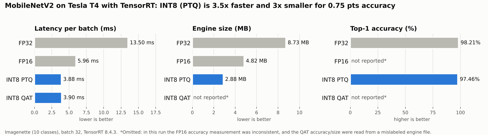
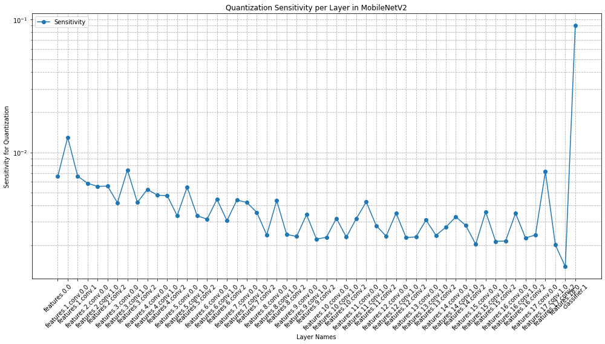
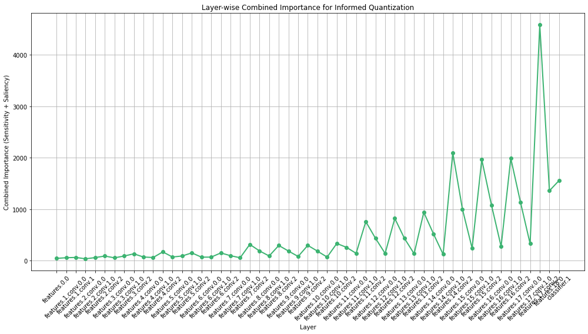

# TensorRT INT8 Quantization for Image Classification (PTQ & QAT)

End-to-end pipeline that takes a PyTorch CNN to optimized **TensorRT** engines in FP32, FP16 and
**INT8** (post-training quantization and quantization-aware training), with a **per-layer
sensitivity analysis** to see where quantization error comes from.

**Headline (MobileNetV2, Tesla T4):** INT8 PTQ cuts latency **3.5×** (13.50 → 3.88 ms per batch of 32)
and engine size **3.0×** (8.73 → 2.88 MB) for a **0.75-point** top-1 accuracy drop (98.21% → 97.46%).



## Results

MobileNetV2 fine-tuned on Imagenette (10 ImageNet classes). Tesla T4, TensorRT 8.4.3, batch 32.
Latency is `trtexec` mean GPU compute time per batch; accuracy is measured by running the TensorRT
engine over the validation set.

| Precision | Top-1 accuracy | Latency / batch | Throughput | Engine size |
|---|---:|---:|---:|---:|
| FP32 (TensorRT) | 98.21% | 13.50 ms | ~2,360 img/s | 8.73 MB |
| FP16 (TensorRT) | n/a¹ | 5.96 ms | ~5,360 img/s | 4.82 MB |
| **INT8 PTQ** | **97.46%** | **3.88 ms** | **~8,230 img/s** | **2.88 MB** |
| INT8 QAT | n/a² | 3.90 ms | ~8,180 img/s | n/a² |

¹ The FP16 engine accuracy recorded in this run (88.65%) is inconsistent with the FP32 and INT8
engines and is excluded. ² The QAT accuracy and size in the archived run were read from a mislabeled
engine file, so they are excluded; QAT latency is from the correct engine. Notebook 02 measures all
four engines end to end on Mini-ImageNet.

## Layer sensitivity analysis

Before choosing per-layer precision, each Conv/Linear layer is scored by how much the loss reacts to
perturbing its weights (normalized gradient sensitivity) and by input saliency.

| Gradient sensitivity per layer (log scale) | Combined importance (sensitivity + saliency) |
|---|---|
|  |  |

The classifier layer is more than an order of magnitude more sensitive than a typical layer, and the
stem (`features.0`–`features.1`) is also elevated. Combined importance rises in the deeper inverted
residual blocks and peaks at `features.17`. These layers are the candidates to keep at higher precision
in a mixed-precision scheme, while the rest go to INT8.

## How it works

1. **Baseline:** fine-tune MobileNetV2 with a new classification head.
2. **ONNX export → TensorRT:** build FP32 and FP16 engines with `trtexec`.
3. **PTQ:** insert fake-quant nodes with NVIDIA `pytorch-quantization`; calibrate weights per-channel
   (max) and activations per-tensor (histogram, 99.9–99.999 percentiles); export Q/DQ ONNX and build
   an INT8 engine.
4. **Sensitivity analysis:** gradient sensitivity and saliency per layer.
5. **QAT:** fine-tune the fake-quantized model, then build its INT8 engine.
6. **Benchmark:** `trtexec` for latency/throughput, a TensorRT runtime loop (PyCUDA) for accuracy.

## Repository layout

```
notebooks/
  01_mobilenetv2_imagenette_results.ipynb   # archived run with recorded outputs (source of the numbers above)
  02_mobilenetv2_miniimagenet.ipynb         # extension: Mini-ImageNet (100 classes), dynamic-batch engines, TRT entropy calibrator
assets/                                     # figures used in this README
requirements.txt
```

## Reproduce

The notebooks were run on Kaggle (GPU: Tesla T4). To run them:

1. Create a Kaggle notebook with a GPU accelerator and add the Imagenette dataset (notebook 01) or
   Mini-ImageNet (notebook 02).
2. Run the setup cell to install TensorRT and `pytorch-quantization`.
3. In notebook 02, set `INPUT_DIR` / `WORK_DIR` in the first cell if you are not on Kaggle.

Outside Kaggle you need an NVIDIA GPU, CUDA, and a matching TensorRT install (see `requirements.txt`).

## Tech

PyTorch · TensorRT 8.4 · ONNX / onnx-simplifier · NVIDIA pytorch-quantization · PyCUDA · trtexec

## Related

- [TensorRT-Quantization-SemanticSegmentation](https://github.com/namrathasanjay/TensorRT-Quantization-SemanticSegmentation):
  the same INT8 QAT workflow applied to FCN-ResNet18 on Cityscapes.
